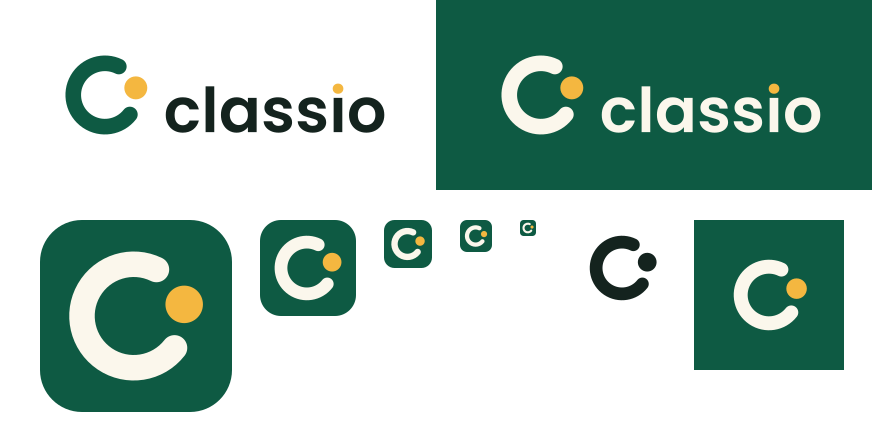

# Classio : identité visuelle et principes d'ergonomie

## 1. Logo : « Le C et le soleil »



Un C ouvert, et dans son ouverture un point jaune.

| Lecture | Sens |
|---|---|
| Le **C** | L'initiale de Classio, et un cercle de classe qui s'ouvre vers les familles. |
| L'**arc** | Une jauge de progression : l'élève avance. |
| Le **point** | Le soleil levant, et surtout la pastille de notification : la note qui arrive sur le téléphone du parent. C'est la promesse du produit. |

Le même soleil devient le point du « i » dans le mot-symbole, ce qui relie la marque au nom.

### Couleurs

| Nom | Code | Rôle |
|---|---|---|
| Forêt | `#0E5A43` | Couleur principale. Le vert évoque la croissance et rappelle le drapeau béninois. |
| Soleil | `#F4B740` | Accent, pastilles. Aussi présent dans le drapeau. |
| Latérite | `#B4472A` | Erreurs et alertes. Inspirée de la terre de barre du sud du Bénin. |
| Ivoire | `#FBF7EC` | Fond de page : plus doux que le blanc, évoque le papier du cahier. |
| Encre | `#14231E` | Texte. |

Contrastes mesurés (WCAG AA exige 4,5:1 pour du texte) :

| Texte sur fond | Ratio | Usage |
|---|---|---|
| Encre sur Ivoire | 15,2:1 | Texte courant |
| Forêt sur blanc | 8,2:1 | Liens, boutons secondaires |
| Ivoire sur Forêt | 7,7:1 | Boutons principaux |
| Encre sur Soleil | 9,1:1 | Texte sur une pastille jaune |
| Latérite sur blanc | 5,4:1 | Messages d'erreur |
| Soleil sur blanc | **1,8:1** | **Interdit pour du texte** : accent uniquement |

Le vert s'éloigne volontairement de celui de la v1 (`#075E54`), qui est presque celui de WhatsApp.
Les parents recevront nos messages dans WhatsApp : le logo ne doit pas passer pour celui de WhatsApp.

### Fichiers

Dans [brand/](brand/) : `classio-logo.svg` (fond clair), `classio-logo-on-dark.svg` (fond sombre),
`classio-icon.svg` (application), `classio-icon-maskable.svg` (Android), `classio-mark.svg`,
`classio-mark-mono.svg` (tampon, impression sur bulletin en noir et blanc).

Le mot-symbole est vectorisé depuis Poppins SemiBold (licence SIL OFL, usage commercial permis).
L'interface, elle, n'emploie aucune police web : la pile système évite un téléchargement sur forfait.

**À faire avant dépôt de marque :** une recherche d'antériorité sur le nom et le logo.

## 2. Principes communs

1. **Une action par écran** sur téléphone. Le parent vient chercher une information, pas naviguer.
2. **Budget de poids :** JavaScript initial sous 150 Ko compressés, écran de consultation sous 50 Ko
   de données API. Ces budgets servent l'objectif du cahier des charges : une note en moins de 2 s en 3G.
3. **Cibles tactiles de 48 px minimum**, texte de 16 px minimum (en dessous, iOS zoome sur les champs).
4. **Le contenu se voit avant le chargement :** on affiche la dernière version connue, avec sa date.
5. **Des mots simples :** « Envoyer à la direction », pas « Soumettre ». Pas de jargon, pas d'anglais.
6. **La couleur ne porte jamais seule l'information :** une note sous la moyenne a aussi une icône.

## 3. Espace parent : connexion par code

Le parent ne crée rien et ne retient rien. Il n'y a qu'un seul champ par écran.

```
┌───────────────────────┐   ┌───────────────────────┐   ┌───────────────────────┐
│       ◖ classio       │   │  ‹ Retour             │   │  Bonjour              │
│                       │   │                       │   │                       │
│  Votre numéro         │   │  Entrez le code       │   │ ┌───────────────────┐ │
│  de téléphone         │   │  reçu sur WhatsApp    │   │ │ Koffi · 6e A      │ │
│                       │   │  au 01 97 •• •• 00    │   │ │ CEG Les Pylônes   │ │
│ ┌───────────────────┐ │   │                       │   │ │ Maths : 14/20 hier│ │
│ │+229 01 97 00 00 00│ │   │  [4] [8] [1] [_][_][_]│   │ │ Moyenne : 12,75   │ │
│ └───────────────────┘ │   │                       │   │ └───────────────────┘ │
│                       │   │  Renvoyer dans 0:45   │   │ ┌───────────────────┐ │
│ [ Recevoir mon code ] │   │  Recevoir par SMS     │   │ │ Awa · CM2         │ │
│                       │   │                       │   │ │ École Saint-Michel│ │
│ Le numéro donné       │   │                       │   │ │ Pas de note récente││
│ à l'école.            │   │                       │   │ └───────────────────┘ │
└───────────────────────┘   └───────────────────────┘   └───────────────────────┘
```

- **Clavier numérique** (`inputmode="numeric"`) et remplissage automatique du code
  (`autocomplete="one-time-code"`), pour que le parent n'ait souvent rien à taper.
- **Même écran pour tous les numéros :** il ne révèle jamais si un numéro est connu d'une école.
- **Le repli est visible :** si WhatsApp n'arrive pas, « Recevoir par SMS » s'active après 45 secondes.
- **Session longue (30 jours) sur le téléphone :** une reconnexion coûte un SMS, et de la patience.
- **Le premier lien d'activation** ouvre directement l'écran du code, avec le numéro déjà rempli.
- **Proposer l'installation de l'application** seulement après la première note consultée, jamais
  à l'arrivée : le parent sait alors à quoi elle sert, et le push remplace des SMS payants.
- **Un parent, plusieurs écoles :** les enfants s'affichent ensemble, le nom de l'école sert de repère.

## 4. Espace enseignant : grille de notes

```
┌───────────────────────────────────────────┐
│ ‹ 6e A · Maths · T1 · Composition    /20  │
│ ● Enregistré sur ce téléphone   ↻ 3 à envoyer
├───────────────────────────────────────────┤
│  Élève                  Note              │
│  ADJOVI Koffi          [ 14   ]           │
│  AGBO Awa              [ 9,5  ]           │
│  AHOUNOU Marc          [ 23   ] ⚠ > 20    │
│  AKPLOGAN Sena         [ Abs. ]           │
│  ALLADE Rita           [      ] vide      │
├───────────────────────────────────────────┤
│ Moy. 11,75 · 38/42 saisies                │
│ [ Envoyer à la direction ]                │
└───────────────────────────────────────────┘
```

- **Une seule colonne par évaluation sur téléphone.** Le classeur complet, avec une colonne par
  évaluation, n'apparaît que sur grand écran.
- **Clavier :** Entrée ou Suivant descend à l'élève suivant ; flèches et Tab sur ordinateur. On saisit
  sans quitter la feuille des yeux.
- **Le clavier décimal accepte la virgule et le point** (`inputmode="decimal"`) : « 9,5 » et « 9.5 »
  donnent la même note.
- **« a » ou « abs » vaut absent.** Une case vide n'est jamais un zéro.
- **Une alerte n'empêche pas de saisir :** note supérieure au barème signalée sur la ligne ; c'est
  l'envoi à la direction qui est bloqué tant qu'une erreur subsiste, avec un lien vers la ligne.
- **La sauvegarde est invisible et permanente :** chaque cellule s'enregistre sur le téléphone à la
  sortie du champ, le bandeau dit l'état en clair. Rien à cliquer, rien à perdre en cas de coupure.
- **Un conflit est montré, jamais écrasé :** si la direction a modifié la note entre-temps, les deux
  valeurs s'affichent et l'enseignant choisit.
- **Grille écrite à la main, avec de vrais `<input>` :** une bibliothèque de tableur pèserait
  plusieurs fois le budget de toute l'application, et une classe tient en une centaine de lignes.
